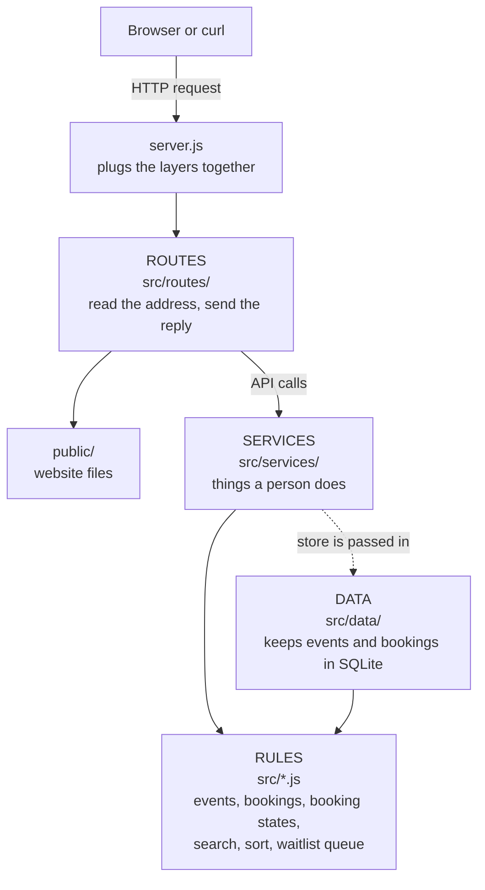

# Architecture (Build 7)

This page shows how the project is organised: what each part is for, which part may talk to which, and what happens when a request arrives.

## What the system must do

Taken from `docs/user-stories.md`.

**Features (what people can do)**
- An organizer creates an event with title, city, venue and date (S02), adds ticket tiers (S03), and publishes or unpublishes it (S04).
- An attendee searches, filters and sorts published events (S05), and books tickets (S06).
- A booking has a life cycle: pending, then paid, cancelled, expired or refunded (see `docs/booking-states.md`).
- Data is stored in SQLite and survives a restart (see `docs/database.md`). Two people can never buy the same last ticket (see `docs/overselling.md`).
- The server answers `/health`, serves the website files in `public/`, and offers a REST API under `/api` (events, tiers, publish, search, booking, mock payment, cancel unpaid). See `docs/api-examples.md`.

**Qualities (how it must behave)**
- Money is a whole number of cents. Never decimals.
- Search and sort never change the original list.
- Every error has the same shape: `{ "error": { "code": "...", "message": "..." } }`.
- The server only ever serves files from the `public/` folder.
- No outside packages. Only Node's built-in tools.

## The four layers

Each layer has one job. A layer may only use the layers listed in the last column.

| Layer | Folder | Its job | May import |
|---|---|---|---|
| **Routes** | `src/routes/` | Read the address, method and JSON body. Ask a service. Send the reply. No business rules, no storage. | routes, services |
| **Services** | `src/services/` | One function per thing a person does, like "book" or "publish". | rules, services |
| **Rules** | `src/*.js` | The business rules: events, bookings, booking states, search, sort, the waitlist queue. | rules |
| **Data** | `src/data/` | Keeps things: in a SQLite file (`sqliteStore.js`), or in memory for quick tests (`memoryStore.js`). | rules |

`src/server.js` is not a layer. It only plugs the layers together. `start.js` starts it.

## Diagram

A solid arrow means "uses it now". A dotted arrow means "uses it, but not directly" or "is built later".

A picture of this diagram is also saved as `docs/architecture.png`, in case your editor does not draw Mermaid.

## What happens when a request arrives

Example: `POST /api/bookings` (book 2 seats)

1. curl sends the request to the server.
2. `server.js` hands it to the router in `src/routes/index.js`. The address starts with `/api`, so it goes to `src/routes/api.js`.
3. `api.js` finds the matching row in its route table, and `body.js` reads the JSON (too big gives 413, wrong type 415, broken JSON 400).
4. The route calls `bookings.book(...)` in `src/services/bookingService.js`.
5. The service asks the rules (`src/bookings.js`) to decide: published? enough seats? Then the store keeps the result.
6. The route turns the booking into a safe reply with `present.js` and sends `201` plus a `Location` header.
7. If anything threw an error, `src/routes/errors.js` turns its code into a status (`SOLD_OUT` gives 409) and sends the standard error shape.

Example: `GET /health`. The router answers it directly with `200 {"status":"ok"}`.

Any other address goes to `src/routes/static.js`. It turns the address into a file path, checks the path is still inside `public/`, and sends the file. If there is no such file, the reply is a 404 in the standard error shape.

## What exists now, and what comes later

| Part | Now (Build 7) | Later |
|---|---|---|
| Routes | `/health`, static files and the REST API under `/api`, login and permission checks | Build 8 and 9: refund and check-in routes |
| Services | Event and booking services, mock payment, used by the routes | Build 8: refunds, waitlist offers |
| Rules | Events, bookings, search, sort, states, mock payment | Build 8: refund amount, waitlist offers, expiry |
| Data | SQLite file with users and owners (memory store kept for tests) | Build 8: refunds, hold expiry |

## Decisions and shortcuts

- **The rules files stay in `src/`.** I did not move the Build 1 and 2 files into a `rules/` folder. Moving them would break the imports and the tests for no gain. The rule is "every file directly in `src/` is a rules file".
- **The store is passed in.** Services receive the store as a parameter instead of importing it. That keeps services free of storage details, and every test gets a fresh, empty store.
- **Two stores, one promise.** `memoryStore.js` and `sqliteStore.js` offer the same functions. `test/sqlite.test.js` runs the same steps on both and demands the same answers, including the same error messages. The whole API test suite also runs on both.
- **`updateEvent`: look, change, save as one step.** Services never do "load, change, save later" on their own, because two requests at the same moment could overwrite each other.
- **The store never trusts the copy of an event it is handed** when booking. It checks the database again inside a transaction.
- **Known shortcut:** `BookingBook` (the in-memory rules class) still exists for the memory store and the Build 1 to 3 tests. The SQLite store does the same job with SQL.
- **No framework.** The server uses Node's built-in `http` module, because the project allows no outside packages.

## How the layering is protected

`test/architecture.test.js` reads every file in `src/`, looks at what it imports, and fails if a layer imports something it should not. It also fails if any file imports an outside package. The test also proves its own checker works, by feeding it deliberately bad examples.

## Decisions made in Build 4

- **Routes may import services, never rules.** So the error class is re-exported by `src/services/errors.js`. `test/architecture.test.js` proves a route importing a rule is caught.
- **Presenters pick fields by name** (`src/routes/present.js`). The waitlist (other people's names) can never leak by accident.
- **The server makes event ids** (`EV-000001`). A client-sent `id` is ignored.
- **One table maps every error code to a status** (`src/routes/errors.js`). A test scans the source and fails if a code has no status.
- **Fixed in Build 7:** `GET /api/events/:id` used to show drafts to everyone. Now only the owner sees a draft.

## The website (added in Build 6)
`public/` is the front door for people. It is NOT part of `src/` and does not import from it.
Inside it, only `public/js/api.js` gets data, through real `/api` calls (since Build 7).
Pages -> `api.js` -> the REST API -> services -> data. See `docs/frontend.md`.

## Login and permissions (added in Build 7)
- Routes read the `Authorization: Bearer` header and ask `authService.authenticate` who the actor is (or nobody).
- Services receive the **actor** and check it with `services/access.js` before doing anything. Routes contain no permission rules.
- Passwords and tokens are rules-layer files (`src/auth.js`, `src/tokens.js`): pure code, no storage, easy to test.
- The data layer gets a `users` table and owner columns. See `docs/auth.md` and `docs/database.md`.
