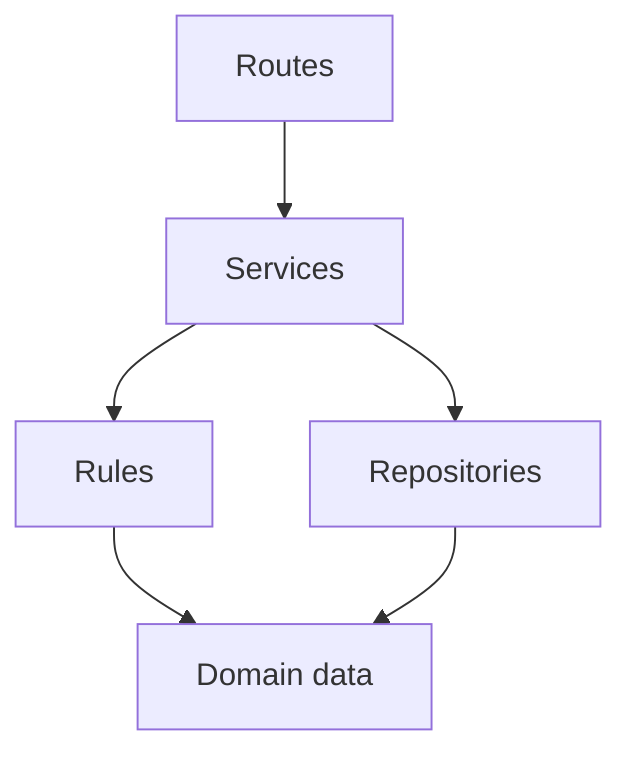
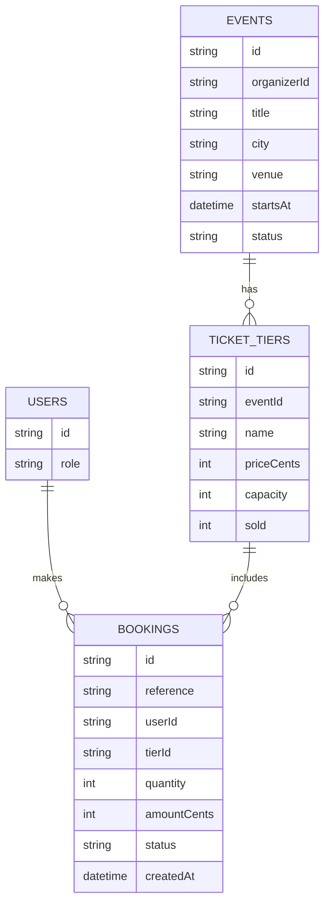
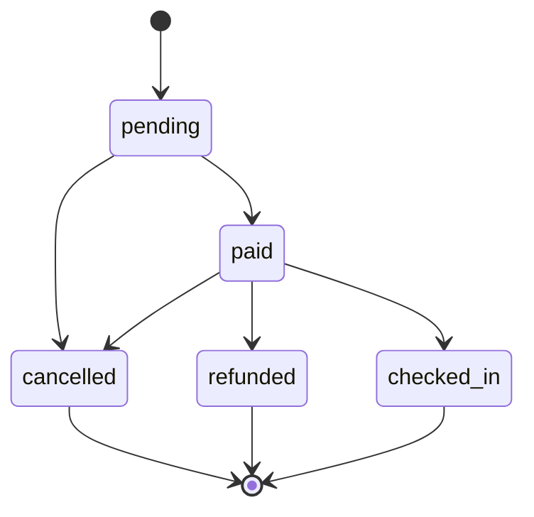

# Build 3 Architecture

## Application layers

- **Routes** may receive HTTP requests and format HTTP responses; routes may not contain booking business rules or access repositories directly.
- **Services** may coordinate use cases and call rules and repositories; services may not handle raw HTTP responses or call routes.
- **Rules** may enforce domain invariants and state transitions; rules may not perform HTTP or database I/O.
- **Repositories** may persist and retrieve data; repositories may not contain route handlers or enforce use-case-level policy.

## Data model

## Booking life cycle

