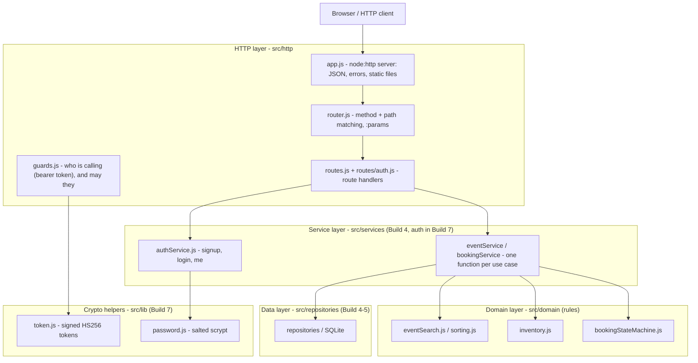
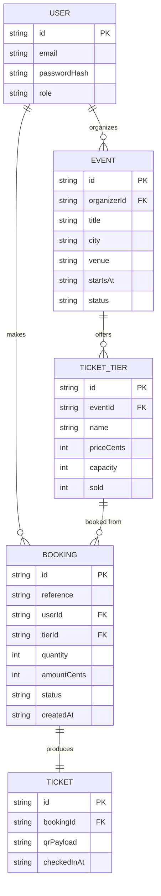
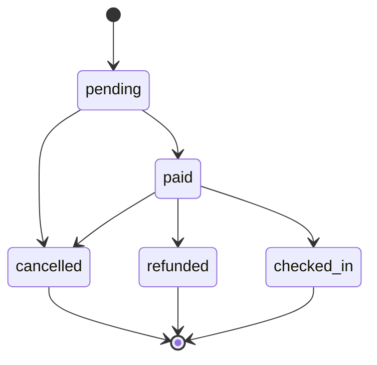

# Architecture: the Event Ticketing capstone

This is the shape of the whole project. We build it up one layer at a time.

## 1. The layers

A request travels down the left column and the answer travels back up. Nothing
calls upwards.



What each layer may and may not do:

- **HTTP layer (`src/http`)** may read the request, match a route, ask the guards
  who is calling, call a service and write the response as JSON or a static file.
  It may **not** hold any business rule, and it never talks to the database or the
  domain rules directly. `guards.js` is the only place that reads the
  `Authorization` header: `requireUser` proves the token and `requireRole` also
  checks the role. The role comes from the signed token, so the page cannot lie
  about it.
- **Service layer (`src/services`)** may run one use case end to end by
  coordinating the domain rules and the repositories, and it may throw
  `DomainError`s. It may **not** know about `req`/`res`, HTTP status codes or
  the browser. From Build 7 the mutating methods also take the caller's id, so
  ownership is a service rule: paying someone else's booking or editing someone
  else's event is refused even if a handler forgot to ask the guard.
- **Crypto helpers (`src/lib`)** hold code with no rules of its own:
  `password.js` hashes with scrypt and a random salt per password, and `token.js`
  signs and verifies HS256 tokens. Neither one decides who may do anything.
- **Domain layer (`src/domain`)** may hold the pure rules: the booking state
  machine, the inventory and capacity rules, search and sorting. It may **not**
  do any I/O, and it knows nothing about HTTP or the database.
- **Data layer (`src/repositories`)** may read and write persistent storage. It
  may **not** contain business rules; it only stores and fetches. `memory.js`
  (Build 4) and `sqlite.js` (Build 5) expose the same async methods, so the
  services never learn where the data lives.

From Build 5 the data lives in SQLite (`src/db/`). One rule is enforced in the
database, not in JavaScript: seats are reserved with a single statement,

```sql
UPDATE ticket_tiers SET sold = sold + ? WHERE id = ? AND sold + ? <= capacity
```

and `CHECK (sold >= 0 AND sold <= capacity)` backstops it. Doing the check and
the write in one statement is what stops two callers from both winning the last
seat; a JavaScript check followed by a write has an `await` in between where the
other caller can slip through.

## 2. The data model



Money is always a whole number of the smallest unit (`priceCents`,
`amountCents`), never a decimal. In SQLite these are `INTEGER` columns,
`bookings.reference` is `UNIQUE`, every foreign key is declared (and enforced
with `PRAGMA foreign_keys = ON`), and `ticket_tiers.sold` carries the
`CHECK (sold >= 0 AND sold <= capacity)` guard.

## 3. The booking life cycle



The same graph lives in code in `src/domain/bookingStateMachine.js`:

- allowed moves: `pending -> paid`, `pending -> cancelled`,
  `paid -> checked_in`, `paid -> refunded`, `paid -> cancelled`;
- `cancelled`, `refunded` and `checked_in` are final: nothing leaves them;
- every other move throws a `DomainError` with the code `INVALID_TRANSITION`.

## 4. Layer directory map

```
src/
  http/     request in, response out      (no business rules)
    app.js
    router.js
    routes.js
    guards.js   who is calling (bearer token) and may they
    routes/
      auth.js   the signup, login and me routes
  services/ one function per use case
    eventService.js
    bookingService.js
    authService.js
  domain/   the pure rules                 (no I/O)
    bookingStateMachine.js
    inventory.js
    eventSearch.js
    sorting.js
    validation.js
    errors.js
    ids.js
    waitlistQueue.js
  repositories/ storage and repositories
    memory.js
    sqlite.js
  db/       the SQLite schema and connection
    schema.sql
    connection.js
  lib/      helpers with no rules of their own
    mockPaymentGateway.js
    password.js  salted scrypt hashing
    token.js     signed HS256 tokens
  config.js environment and defaults
  server.js the entry point
public/     the browser app: static files served by app.js
  index.html      browse events (search, city, max price, sort)
  event.html      one event, its tiers and checkout
  login.html      log in or sign up
  tickets.html    my tickets (private)
  organizer.html  create events and tiers, publish
  css/
    styles.css
  js/         ES modules, no framework, no build step
    ui.js       tiny el()/format helpers (textContent only, never innerHTML)
    session.js  the token and user in the browser (the only storage user)
    api.js      the ONE data access point the pages import (fetch)
    nav.js      the account links in the header
    pages/
      home.js
      event.js
      login.js
      tickets.js
      organizer.js
```

## 4a. Authentication and authorization (Build 7)

The difference the two words name is worth keeping straight:

- **Authentication** ("who are you") is `POST /api/auth/signup` and
  `POST /api/auth/login`, which return `{ user, token }`; every later request
  carries the token in `Authorization: Bearer <token>`, and `requireUser`
  verifies it.
- **Authorization** ("may you do this") is the role check in `requireRole` and
  the ownership checks inside the services. It is **always** answered on the
  server. A page hiding the "My events" link from an attendee is convenience,
  not a control: the endpoint still refuses.

Passwords: `signup` hashes with `scrypt` and a fresh random salt per password
(stored as `scrypt$<salt>$<key>`), and `login` compares in constant time. The
hash is never returned, logged or put in a token; the only shape a user leaves a
service in is `{ id, email, role }`.

Tokens: `token.js` builds `header.payload.signature` with HMAC-SHA256, requires
an `exp`, and refuses any header whose `alg` is not exactly `HS256` (so the
classic "alg: none" forgery fails). The secret comes from `TOKEN_SECRET`; with
no variable set a random one is made per process and a warning is printed, so a
token is never signed with a secret that is checked into git.

## 5. The browser app (Build 6-7)

The screens run in the browser as plain ES modules, and since Build 7 they talk
to the real API. One rule keeps them honest: **the pages never call `fetch`.**
They import from `public/js/api.js`, which is now a thin `fetch` wrapper whose
functions resolve to the shapes in `docs/api-examples.md`. Build 6's mock data
(`mockData.js`) and its copy of the filter/sort rules are gone: the server does
the filtering, and `api.js` only turns the filter form into a query string.

- `public/js/session.js` is the only module that touches storage: it keeps the
  token and user in `localStorage` (memory when there is none, which is what
  `node:test` uses) and offers `loginUrl(next)` to come back after logging in.
- `api.js` sends `Authorization: Bearer <token>` whenever a session exists, and
  drops the session when the server answers `UNAUTHENTICATED` (an expired or
  edited token is not worth keeping).
- `public/js/nav.js` paints the account links. Hiding a link is convenience;
  the server enforces every rule regardless.
- A sold-out tier (`seatsLeft === 0`) is marked and its button is disabled, and
  a signed-out visitor sees a "log in to book" link instead of a Book button.
- A quantity is clamped to at most 10 and at most the seats left
  (`clampQuantity` in `public/js/ui.js`).
- Checkout shows a countdown while the seats are held; a declined card shows an
  error and leaves the Pay button enabled to retry.

Build 6's frontend tests still run: `test/frontend.test.js` now stubs
`globalThis.fetch`, so it can check the request the page would have sent (the
bearer header, the query string) and what it does with a reply or a failure.
