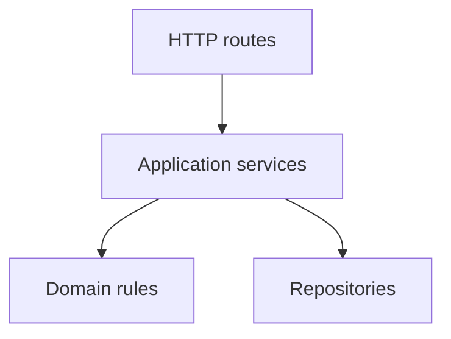
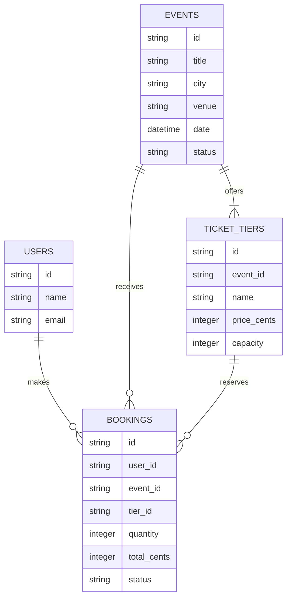
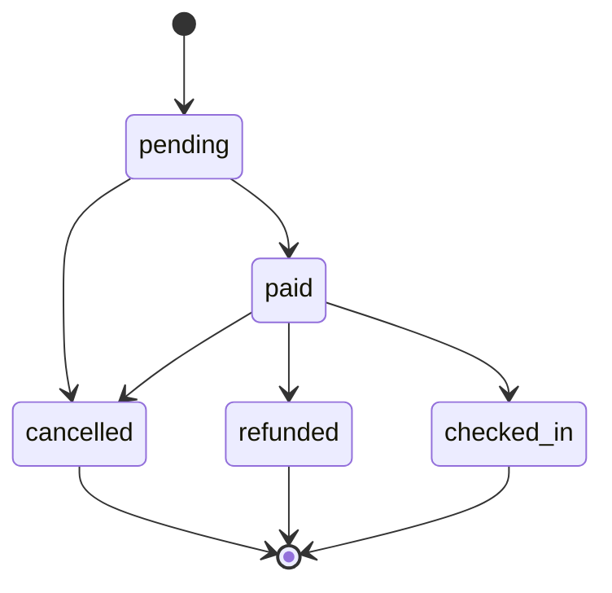

# Build 3 Architecture

## Layers

- **Routes** may parse HTTP input and format HTTP responses; they may not implement business rules or access persistence directly.
- **Services** may coordinate use cases by calling domain rules and repositories; they may not contain transport-specific behavior or bypass domain rules.
- **Domain rules** may enforce business invariants using domain data; they may not depend on HTTP, services, or repositories.
- **Repositories** may load and save data; they may not make business decisions or call services or routes.

## Data model

## Booking life cycle

