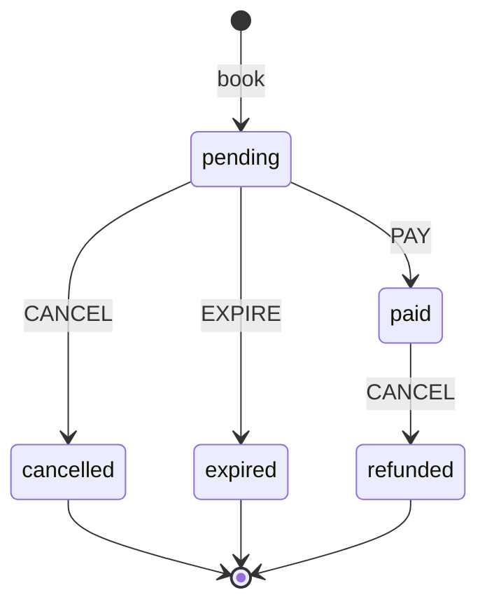

# Booking life cycle (Build 4)

A booking is always in exactly one state. Something happens to it (an **event**), and the state changes. If a move is not in the table, it is refused.

## Diagram

A picture of this diagram is also saved as `docs/booking-states.png`, in case your editor does not draw Mermaid.

## The rules, as a table

A dash means the move is refused with `INVALID_STATE`.

| State now | PAY | CANCEL | EXPIRE |
|---|---|---|---|
| **pending** | paid | cancelled | expired |
| **paid** | - | refunded | - |
| **cancelled** | - | - | - |
| **expired** | - | - | - |
| **refunded** | - | - | - |

5 states times 3 events is 15 combinations. 4 are allowed. The other 11 are refused. `test/states.test.js` checks all 15.

## What each state means

| State | Meaning | Holds seats? |
|---|---|---|
| pending | Booked, not paid yet | Yes |
| paid | Paid for | Yes |
| cancelled | Cancelled before paying | No |
| expired | Not paid in time | No |
| refunded | Cancelled after paying | No |

`cancelled`, `expired` and `refunded` are **final**. A booking in a final state cannot move again.

## Rules that follow from the table

- **Seats go back exactly once.** They are released only when a booking leaves a seat-holding state (pending or paid). A second cancel is refused, so it cannot release them again.
- **Paying a cancelled booking is refused.** The booking stays cancelled and the seats are not taken again.
- **Paying twice is refused.**
- **A refused move changes nothing.** The next state is worked out first. Only if the move is allowed is anything changed.

## Errors

| What happened | Error code |
|---|---|
| A move that is not in the table, like paying a cancelled booking | `INVALID_STATE` |
| Cancelling a booking that is already cancelled or refunded | `ALREADY_CANCELLED` |
| A booking code that does not exist | `NOT_FOUND` |

## What is built now and what comes later

| Part | Build |
|---|---|
| The table, and the PAY and CANCEL moves in `BookingBook` | 3 |
| The mock payment (a pretend card) and the API calls | 4 (now) |
| The refund amount, based on how close the event is | 8 |
| The EXPIRE move being triggered automatically after a time | 8 |

The `EXPIRE` move is already in the table, so Build 8 only has to trigger it.

## How the API uses it (Build 4)

- `POST /api/bookings/:ref/pay` asks the table first ("is PAY allowed?"), then charges the mock card, then moves the booking to `paid`. A declined card (`tok_declined`) leaves the booking `pending`.
- `POST /api/bookings/:ref/cancel` only cancels **unpaid** bookings. A paid booking gets `INVALID_STATE` ("needs a refund"), because refunds are built in Build 8.
