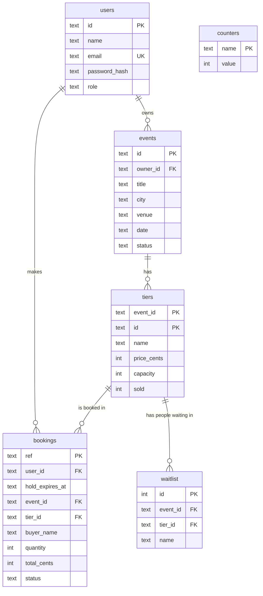

# The database (Build 7: schema version 2)

Data lives in one SQLite file: `data/tickets.sqlite` (the `data/` folder is **not** committed to Git).
SQLite is built into Node (`node:sqlite`, Node 22.13 or newer), so there is nothing to install.

## Tables

| Table | What it keeps |
|---|---|
| `users` | One row per account: name, unique email, password **hash**, role (`attendee`, `organizer`, `staff`). |
| `events` | One row per event, with its `owner_id`. `status` is `draft` or `published`. |
| `tiers` | The ticket types of an event, with `capacity` and `sold`. Identified by event id plus tier id. |
| `bookings` | One row per booking, with `user_id` (who booked) and `hold_expires_at`. `status` is one of `pending`, `paid`, `cancelled`, `expired`, `refunded`. |
| `waitlist` | People waiting for a sold-out tier. The lowest `id` is the front of the line. |
| `counters` | The next number for `EV-000001` and `BK-000001`, so ids keep counting after a restart. |

## Rules the database enforces itself (constraints)

| Rule | How |
|---|---|
| `sold` is never negative and never above `capacity` | `CHECK (sold >= 0 AND sold <= capacity)` |
| Price is 0 or more, capacity is 1 or more, with upper limits | `CHECK` on `price_cents` and `capacity` |
| A booking is for 1 to 10 tickets | `CHECK (quantity >= 1 AND quantity <= 10)` |
| A booking has a real status | `CHECK (status IN (...))` |
| A booking or waitlist entry must point at a real tier | `FOREIGN KEY (event_id, tier_id)` |
| A tier id is used once per event | `PRIMARY KEY (event_id, id)` |

The Build 1 to 4 rules in `src/*.js` still decide first and give friendly errors. The constraints are the **last safety net**.

## Money and numbers

Prices are whole **cents** in an `INTEGER` column, never decimals.
Upper limits (N1,000,000,000.00 per ticket, 1,000,000 seats per tier) keep numbers inside the range both the database and JavaScript can hold exactly.

## Parameterised queries

Every value reaches SQL through a `?`, for example `WHERE id = ?`. We never build SQL by gluing text together, so a title like `x'); DROP TABLE events; --` is stored as plain text and does nothing. A test reads `sqliteStore.js` and fails if any query has a value glued in.

## Schema version

SQLite keeps a number inside the file (`PRAGMA user_version`). It is `2` now. Version 2 (Build 7) adds the `users` table and the owner, user and hold columns. A version 1 file is **upgraded automatically** the first time the server starts, keeping all data. Old events and bookings get no owner (`NULL`), so nobody can change them.
A new file gets the tables created. A file from a **newer** version of the project is refused with a clear message, so an old copy of the code can never damage a newer database. Every future change to the tables bumps this number and adds one more upgrade step.

## Where the file lives, and starting fresh

| Want | Do |
|---|---|
| Normal use | `npm start` (uses `data/tickets.sqlite`, created for you) |
| A clean, empty database for trying the curl examples | `set DB_FILE=:memory:&& npm start` (lost when you stop) |
| A different file | `set DB_FILE=C:\temp\test.sqlite&& npm start` |
| Throw everything away | stop the server, delete the `data` folder |

## Known shortcuts

- Search (`GET /api/events?...`) still loads the events and filters them with the Build 2 code. That is fine at this size and keeps one set of tested rules. Moving filters into SQL can come later.
- Money limits and the schema are the same for tests and for real use.
