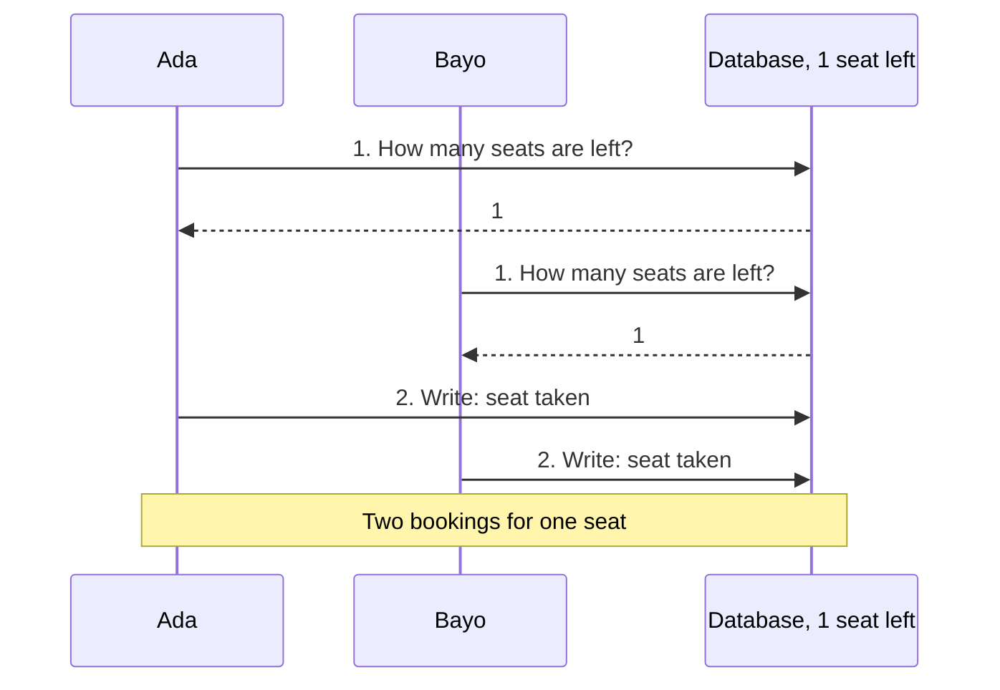
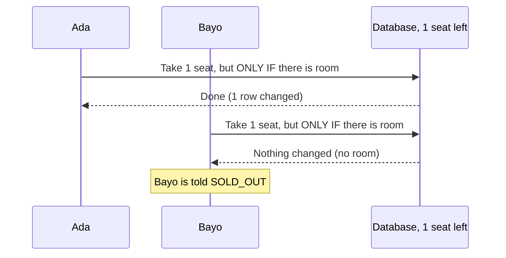

# The last-ticket problem (story S08)

## In simple words

Imagine a shop with **one** cake left. Two people walk in at the same moment.

1. Ada looks at the shelf: "1 cake. Good."
2. Bayo looks at the shelf: "1 cake. Good."
3. Ada takes it. Bayo takes it too.

Now two people think they own one cake. For tickets, that means **two people arrive at a full event**.

The mistake is not in the looking. The mistake is that the look and the taking were **two separate steps**, so someone else could sneak in between them.

## The bug (what NOT to do)



The buggy code is kept on purpose in `scripts/naiveBooking.js`, so you can see it and run it.
`npm run demo:oversell` shows it selling **50 bookings for 1 ticket**.

## The fix (what the project does)



The look and the taking are now **one step**. In `src/data/sqliteStore.js` it is this one SQL statement:

```sql
UPDATE tiers
SET    sold = sold + ?                  -- take the seats
WHERE  event_id = ? AND id = ?
  AND  sold + ? <= capacity             -- ...but only if they fit
```

If no row changed, there was no room, so the answer is `SOLD_OUT` and nothing was written.

## Three layers of protection

| Layer | What it does | Where |
|---|---|---|
| 1. The guarded `UPDATE` | Look and take in one step | `sqliteStore.js`, `bookings.book` |
| 2. A transaction (`BEGIN IMMEDIATE`) | The whole booking (seats, booking code, new row) happens all together or not at all, and only one writer at a time | `sqliteStore.js`, `inTransaction` |
| 3. A `CHECK` constraint | The database itself refuses `sold > capacity`, even if a future bug forgets layers 1 and 2 | `sqliteStore.js`, the `tiers` table |

Another small rule: the store **ignores the copy of the event it is handed** when deciding. That copy may be old. It looks at the database again, inside the transaction.

## How the tests prove it

All in `test/sqlite.test.js`, group "S08: the last ticket":

- **Stale copy test.** Take a look at the event (1 seat left), let someone else buy the seat, then try to book using the old look. It must say `SOLD_OUT`.
- **50 people on 5 separate database connections** all start at the same instant (`scripts/crowd.js`). Exactly 1 wins, 49 get `SOLD_OUT`, and `sold` equals the capacity. It runs 3 times.
- **50 simultaneous HTTP requests** give one `201` and 49 `409 SOLD_OUT`.
- **The buggy code is run through the same crowd and DOES oversell.** That proves the test is able to fail. A test that can never fail proves nothing.
- **A raw SQL check** shows the database refuses `sold` above capacity on its own.

I also broke the fix on purpose (removed the guard, removed the check, trusted the old copy, removed the transaction) and the tests failed each time.

## Why single-process Node did not hit this by itself

`node:sqlite` is synchronous, so inside **one** Node process two bookings cannot overlap by accident. The bug appears when:

- the code has an `await` between the look and the write (the demo does this on purpose), or
- there is more than one server process (or a database driver that waits), which is how real websites run.

The fix is correct in every one of those situations, and that is why it lives in the database step and not in "we only run one process".
